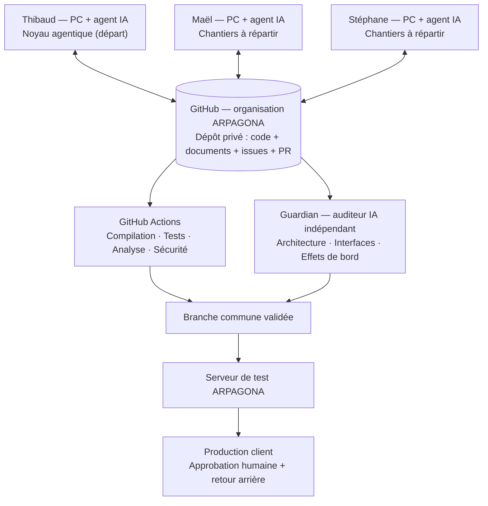

# ARPAGONA — Atelier de développement collaboratif d’Agent Core

**Document de cadrage — version 0.1**  
**Date : 10 novembre 2026**  
**Participants : Thibaud, Maël, Stéphane**  
**Statut : synthèse des échanges ; principes retenus et propositions restant à valider**

> **Principe fondateur :** trois co-concepteurs à responsabilité égale, travaillant chacun sur son PC avec son agent de codage, au sein d’un même atelier GitHub. Chacun est libre d’évoluer à l’intérieur d’un module, mais toute modification des interfaces communes doit faire l’objet d’une validation collective.

## 1. Objectif de l’atelier

Construire **Agent Core**, un socle logiciel agentique réutilisable, fiable et adaptable aux besoins métier d’ARPAGONA. L’environnement de développement doit permettre de :

- développer **en parallèle**, depuis trois postes indépendants, sans dégrader le travail des autres ;
- conserver une **architecture cohérente**, documentée et compréhensible par les humains comme par les agents IA ;
- détecter les régressions, les changements d’interfaces et les problèmes de sécurité **avant intégration** ;
- livrer d’abord sur un environnement de **test**, puis en **production après autorisation humaine** ;
- isoler les installations et données de chaque client, qu’elles soient hébergées chez lui ou sur l’infrastructure ARPAGONA.

La méthode s’inspire d’un **bureau d’études d’ingénierie système** : exigences, architecture, interfaces, traçabilité des décisions, vérifications et validation.

## 2. Décisions déjà prises

| Sujet | Orientation retenue |
|---|---|
| Équipe | Thibaud, Maël et Stéphane sont **trois co-concepteurs à responsabilité égale**. Pas de chef permanent imposé. |
| Point de départ | **Thibaud démarre le noyau agentique** d’Agent Core. |
| Langage du noyau | **Rust**, avec organisation modulaire ; recours possible à des adaptateurs isolés en Python quand nécessaire. |
| Collaboration | **GitHub Cloud**, au sein d’une **organisation ARPAGONA** et d’un **dépôt privé** ; pas de GitLab auto-hébergé au démarrage. |
| Poste de travail | Chacun conserve son PC, son environnement de développement et son agent de codage. |
| Connaissance commune | Documents de référence **Markdown** versionnés avec le code. |
| Lecture humaine | Visualisation **HTML** des modules, contrats et dépendances, générée à partir des sources de référence. |
| Qualité | Un dispositif **Guardian**, indépendant des agents qui codent, examine les changements proposés. |
| Interfaces | Les changements d’interfaces communes font l’objet d’une **revue collective**. |
| Livraisons | Version commune testée sur serveur de test ; **validation humaine explicite** pour la production. |
| Clients | **Séparation stricte des environnements et des données par client** ; les moyens exacts d’isolation restent à concevoir. |

**À ne pas confondre :** le dépôt GitHub peut être privé même si plusieurs composants logiciels utilisés sont open source. **La publication éventuelle du code d’Agent Core en open source n’a pas été décidée.**

## 3. Organisation technique : trois PC, un atelier commun



**Trois personnes sur un même projet** ne signifie pas trois parties techniques arbitraires. Le logiciel est découpé selon ses responsabilités fonctionnelles ; les personnes peuvent changer de chantier au fil du temps.

### Quel est le rôle de Git ?

- **Commit** : enregistrement local d’une modification sur le PC du développeur. Il ne publie rien à lui seul.
- **Push** : envoi de la branche locale vers le dépôt GitHub commun.
- **Pull request (PR)** : demande de revue et d’intégration d’une branche dans la branche commune.
- **Merge** : intégration effective, conditionnée aux contrôles convenus.
- **Déploiement** : installation d’une version construite sur un serveur de test ou de production ; il est distinct du merge.

Chacun peut donc committer localement autant que nécessaire. **Guardian n’a pas à approuver chaque commit local : son contrôle est déterminant avant le merge et les déploiements.** Des contrôles rapides peuvent également s’exécuter en local avant chaque commit ou push.

## 4. Architecture initiale envisagée pour Agent Core

**Proposition technique, et non architecture définitivement figée.** Un *Cargo workspace* Rust pourrait séparer les responsabilités en plusieurs *crates* :

| Module pressenti | Responsabilité principale |
|---|---|
| `agent-core` | Boucle agentique, choix d’actions, traitement des missions et orchestration de haut niveau. |
| `memory` | Contexte, connaissances, mémoire persistante, politique de stockage. |
| `tools` | Catalogue et invocation des outils, connecteurs et adaptateurs externes. |
| `runtime` | Exécution de tâches, files de travail, gestion asynchrone, événements et reprise sur erreur. |
| `security` | Autorisations, limites d’action, isolation logique et gestion des secrets. |
| `interface` | API, outils de supervision et éventuelle interface utilisateur. |
| `skills` | Compétences métier spécialisées, sans modifier le noyau pour chaque client. |

Chaque module devra préciser : **sa responsabilité, ses limites, ses entrées/sorties, ses dépendances et ses tests de contrat**. Le périmètre réel des modules sera ajusté pendant le cadrage collectif.

### Premier jalon : cadrage du noyau par Thibaud

Thibaud décrit dans `docs/ARCHITECTURE.md` :

1. les **quatre ou cinq responsabilités** centrales du noyau agentique ;
2. ce que le noyau **ne doit pas gérer** directement ;
3. ses interactions avec la mémoire, les outils, l’exécution et la sécurité ;
4. les **premières interfaces proposées**, à ce stade encore modifiables ;
5. un scénario de fonctionnement minimal permettant de vérifier l’architecture.

Ce document est proposé en **pull request** à Maël et Stéphane. Ils commentent et discutent les interfaces ; la version commune est approuvée collectivement **avant de lancer les développements parallèles qui dépendent de ces contrats**. Cela évite que l’architecture devienne un fait accompli du seul fait que Thibaud commence à coder.

## 5. Mémoire collective : Markdown comme référence, HTML comme lecture

**Le point d’appui des trois agents n’est pas leur mémoire conversationnelle.** C’est un ensemble de fichiers de référence suivis dans Git, relus et mis à jour avec le code.

```text
arpagona-agent-core/
├── AGENTS.md                  # Consignes communes aux agents
├── Cargo.toml                 # Workspace Rust
├── docs/
│   ├── VISION.md              # Objectifs, usages et limites
│   ├── ARCHITECTURE.md        # Modules et responsabilités
│   ├── INTERFACES.md          # Contrats entre modules
│   └── decisions/             # Registre des décisions (ADR)
│       ├── 0001-choix-rust.md
│       └── 0002-isolation-clients.md
├── crates/                    # Code Rust par responsabilité
├── tests/                     # Tests transverses
└── .github/
    └── workflows/
        └── validation.yml     # Automatisation des contrôles
```

- **`AGENTS.md`** : règles de travail, documents à consulter, commandes de validation, limites des agents. Selon l’outil de codage utilisé, il peut être nécessaire de configurer explicitement sa lecture.
- **`VISION.md`** : pourquoi Agent Core existe, à quels problèmes il répond et ce qu’il ne cherche pas à faire.
- **`ARCHITECTURE.md`** : responsabilités et dépendances entre modules.
- **`INTERFACES.md`** : contrats, types de données, erreurs, compatibilité et règles d’évolution.
- **`decisions/`** : *Architecture Decision Records* (ADR) : problème, options, décision, justification, conséquences.
- **GitHub Issues** : tâches et demandes de modification ; **pull requests** : revue et historique des décisions liées au code.

En complément, un **site HTML généré automatiquement** à partir de ces documents et, si possible, de l’analyse du code, servira aux humains : schéma des modules, dépendances, interfaces, état des décisions et navigation vers la source. **Le HTML est une vue, pas une seconde source de vérité.**

## 6. Cycle de travail proposé

1. **Choisir un chantier** : une Issue décrit la fonction, les exigences, les modules touchés et les critères d’acceptation.
2. **Synchroniser le poste** : le développeur et son agent récupèrent la dernière référence commune et lisent les documents pertinents.
3. **Créer une branche dédiée** : par exemple `feature/memory-persistence`, sans travailler directement dans `main`.
4. **Développer et tester localement** : commits libres, compilation et tests ; si une interface publique doit changer, le chantier passe par une discussion collective.
5. **Ouvrir une PR** : l’agent expose le besoin, les fichiers modifiés, les contrats concernés, les tests et les risques éventuels.
6. **Lancer les contrôles** : CI déterministe + Guardian indépendant + revue humaine prévue par la gouvernance.
7. **Intégrer la modification** uniquement quand les critères d’acceptation sont remplis.
8. **Déployer sur le serveur de test**, vérifier le fonctionnement global et conserver une procédure de retour arrière.
9. **Déployer en production** uniquement après validation humaine explicite, avec séparation des instances clientes.

Pour éviter les collisions, chaque chantier a **un pilote temporaire** et, si nécessaire, un relecteur ; les responsabilités tournent. Chacun reste co-responsable des décisions structurantes et conserve la possibilité d’intervenir sur les modules.

## 7. Guardian : auditeur indépendant, pas juge infaillible

Guardian examine les PR à partir du **code réel**, des **documents de référence** et des **exigences/test d’acceptation**. Il produit un rapport concret : validation, réserves, incompatibilités et corrections demandées.

### Contrôles automatiques, objectifs et reproductibles

- Formatage et compilation Rust : `cargo fmt --check`, `cargo check --workspace`.
- Qualité du code : `cargo clippy --workspace --all-targets -- -D warnings`.
- Tests : `cargo test --workspace` ; puis tests de contrat, d’intégration et de non-régression ciblés.
- Contrôles adaptés au projet : dépendances, secrets, droits d’accès et sécurisation des déploiements.

### Revue IA contextualisée

Guardian vérifie notamment :

- le respect des responsabilités de chaque module et de ses interfaces ;
- les régressions possibles dans les autres modules ;
- la cohérence **architecture déclarée ↔ code réellement implémenté** ;
- les impacts sur la sécurité, les permissions et l’isolation des données clients ;
- la nécessité de mettre à jour une décision d’architecture ou la visualisation HTML.

**Une IA peut se tromper.** Un vote entre plusieurs agents n’est ni une preuve de correction ni un substitut aux tests et aux autorisations humaines. Aucun agent ne doit **autoriser seul l’intégration de son propre travail** ; Guardian ne doit pas pouvoir modifier seul ses critères de contrôle ou les règles de déploiement.

### Verrou réel à installer

Les contrôles ne doivent pas être simplement des conseils facultatifs : le processus d’intégration doit les faire respecter **autant que la formule GitHub retenue le permet**. Les restrictions de protections obligatoires sur dépôt privé avec GitHub Free devront être vérifiées lors de la configuration ; **une convention d’équipe ne fournit pas la même garantie technique qu’une protection de branche imposée**.

## 8. Environnements et données clients

- **Développement local** : environnement personnel, données synthétiques, secrets non committés.
- **CI et revue** : environnement d’exécution isolé, accès minimaux, aucune donnée client nécessaire.
- **Intégration/test ARPAGONA** : installation commune pour valider l’ensemble du système, sur données fictives ou autorisées.
- **Production par client** : déploiement chez le client ou sur infrastructure ARPAGONA, avec **environnement distinct**, contrôle d’accès, secrets dédiés, sauvegardes et politique de mise à jour propres.

L’isolement « un serveur ou une instance par client » est une **direction de conception** : il faudra préciser la séparation réseau, le stockage, l’accès aux modèles, les journaux, les sauvegardes et les droits administrateurs. Une séparation apparente ne suffit pas à démontrer la confidentialité.

## 9. Décisions restant ouvertes

| Question | État |
|---|---|
| Répartition initiale des autres chantiers entre Maël et Stéphane | **Non décidée**. |
| Outil de codage IA utilisé sur chaque PC | **Non décidé** ; l’atelier doit fonctionner avec des outils différents. |
| Première version exacte des modules et des interfaces | **À proposer par Thibaud**, puis à discuter à trois. |
| Mode d’arbitrage en cas de désaccord | **Non décidé** ; privilégier, quand c’est possible, un prototype comparatif et des critères mesurables. |
| Détails de la chaîne Guardian et de ses permissions | **À concevoir et tester** ; éviter une approbation artificielle ou auto-attribuée. |
| Niveau de garanties techniques disponible avec GitHub Free | **À vérifier pour les dépôts privés** et à ajuster si besoin. |
| Hébergement exact du serveur de test | **À préciser**, sans changer le choix GitHub Cloud pour le code. |
| Périmètre de la vue HTML et son générateur | **À prototyper** ; source de vérité toujours versionnée en Markdown. |

## 10. Première expérience à réaliser ensemble

**Objectif : valider l’atelier avant d’y investir le développement complet d’Agent Core.**

- Créer une organisation GitHub et un dépôt privé, avec accès équivalent pour les trois fondateurs.
- Écrire la version initiale de `AGENTS.md`, `VISION.md` et `ARCHITECTURE.md`.
- Faire proposer par Thibaud les responsabilités et premiers contrats du noyau en PR ; recueillir les commentaires de Maël et Stéphane.
- Créer **deux crates Rust simples** ; faire évoluer séparément un module depuis deux PC.
- Faire tourner la CI et une première version de Guardian sur une PR comportant volontairement une incompatibilité d’interface.
- Vérifier que l’incompatibilité est détectée **avant intégration**, puis produire une version commune et la déployer sur le serveur de test.
- Générer une **première page HTML** présentant les modules, leurs contrats et leur lien avec les documents de référence.

**Critère de réussite :** trois participants et leurs agents peuvent développer en parallèle, comprendre les mêmes règles, détecter une rupture d’interface, corriger la PR et obtenir une version commune testée sans ambiguïté.

---

### Charte condensée à conserver

**Liberté à l’intérieur des modules. Discipline collective aux interfaces. Documentation partagée, tests reproductibles et Guardian indépendant avant intégration.**

*Ce document est une base de travail, non un cahier des charges figé. Les décisions collectives futures devront être datées, justifiées et versionnées.*
